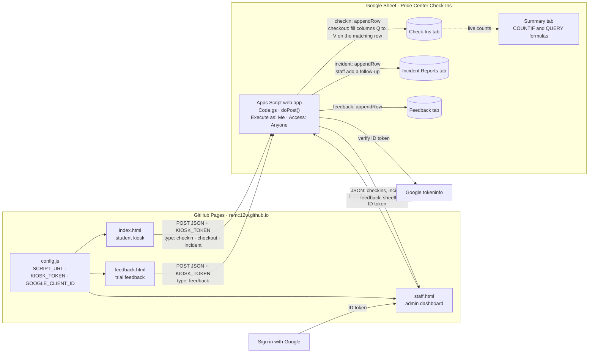
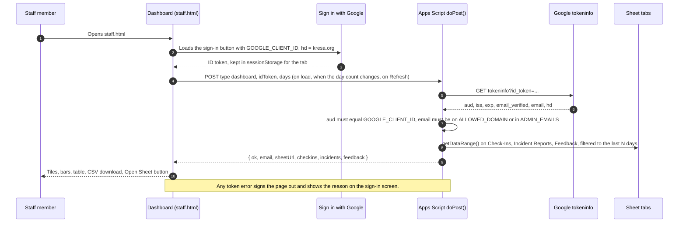

# Panther Pride Center – Student Check-In

A tap-through check-in kiosk for the Pride Center, rebuilt from the Google Slides deck so that every check-in is recorded in a Google Sheet and admins can see who came in, why, and how they were feeling.

- **Kiosk (live):** https://remc12w.github.io/panther-pride-checkin/
- **Staff sign-in (one link for all adults):** https://remc12w.github.io/panther-pride-checkin/login.html — sign in once and it sends you to the principal dashboard, the staff dashboard, or a choice of both, depending on your access. Opening either dashboard directly while signed out goes here too.
- **Google Sheet:** [Pride Center Check-Ins](https://docs.google.com/spreadsheets/d/1CefuY4Uq8CgEqR6PQteZO4W02puMwbYvrsCOxdRQIgw/edit)
- **Repo:** https://github.com/REMC12W/panther-pride-checkin (GitHub Pages serves the `master` branch)

**What's in here**

| File | What it is |
|---|---|
| `index.html` | The student kiosk. Open this on the iPad. |
| `staff.html` | Admin dashboard behind "Sign in with Google". In test mode, shows device-only data. |
| `config.js` | The only file you edit: script URLs, kiosk name, timers, basic-needs list. |
| `apps-script/Code.gs` | Backend that lives inside the Google Sheet. Verifies dashboard sign-ins. |
| `apps-script/appsscript.json` | Optional manifest (sets the Michigan time zone). |
| `principal.html` | Principal dashboard: build-your-own boards of charts over the check-in data. Demo data until `PRINCIPAL_DEMO` is false. Uses `principal-data.js`, `principal-charts.js`, `principal-app.js`, and the Vega chart library in `assets/vendor/`. |
| `feedback.html` | Trial feedback portal. Switch off with `FEEDBACK_ENABLED` in `config.js`. |
| `sw.js` | Service worker. Lets the kiosk open with no Wi-Fi and keeps files fresh when online. |
| `ds.css` | Parchment Panthers Design System tokens (colors, Raleway type, buttons, corners) shared by every page. |
| `icons.js` | Lucide icons bundled for offline use. In `config.js`, an item's `icon` is a Lucide icon name. |
| `assets/` | District panther logo and app icons. |

## The flow

Matches the hyperlinks in the current PowerPoint deck.

1. Start → the student types their name and taps it in the roster name list (see "The roster name list" below)
2. Why are you here today? **I came on my own** (I have a need) or **Staff Referred** (a teacher sent me)
3. Self-referred: What do you need today? **I Need a Reset**, **Scheduled Break**, or **I have a need… (sickness, food, clothing, or to report something)**. Staff-referred: Why did a teacher send you? **Break**, **Defiance**, or **Sickness**. Staff-referred students never see Scheduled Break.
4. **I have a need** goes to: Incident Report or Basic Need. Incident Report opens a short in-app report: What happened (multi-select from `INCIDENT_TYPES`) → Where (`INCIDENT_PLACES`, with Bus/Bus Stop) → When (`INCIDENT_PERIODS`: Before School, Breakfast, the class hours, Lunch, Recess, Passing Time) → Tell us what happened (own words, who was involved, witnesses) → Do you want to talk to someone today? There is no "Are you safe?" question and no grade question: the script fills in the student's grade from the roster. Reports land in an **Incident Reports** tab in the Sheet and in the admin dashboard, where an adult records a follow-up. Basic Need opens "What do you need?" where the student taps one or more items from `BASIC_NEEDS` in `config.js`, then continues to the feelings questions below.
5. How is your body + brain feeling? (Fast / Slow / Ok)
6. "Pick the word that fits how you feel." Fast shows the red and yellow grids, Slow shows blue, Ok shows green. A student can tap one word, or tap **Type my own word** under a grid and type it; the Sheet records their word with that grid's color.
7. Did something happen… (At Home / With my Teacher / With a friend / Just with myself / Nothing happened / I'm not sure right now)
8. Station suggestion. The mood word's color picks a regulation station (Red, Yellow, Blue, Green). The app says "Suggested: Blue station. You can pick another," and records both the suggestion and the choice. Every word goes to the station picker, including the alert words in `STAFF_FIRST_WORDS` (enraged, hopeless, and so on), since an adult is already with the student. A tapped alert word is saved with "Staff first" in Station Suggested, which raises "Staff should go to this student" on the staff dashboard. A word the student typed never raises an alert.
9. End screen with the deck's CLICK HERE button: Incident Report opens the incident form, Check In and Basic Need open the sign-in form. Both need a KRESA Google login, exactly as before. Clear `FORM_INCIDENT_URL` or `FORM_SIGNIN_URL` in `config.js` to hide a button. The app resets for the next student after 30 seconds.

**Already checked in?** After typing their name, a student who already has an open check-in today on that iPad (within 4 hours, not checked out) sees "Welcome back" with two choices: check out, or start a new visit. A student who taps check-out without a check-in sees "We don't see a check-in for you today" with: check in, or check out anyway. So nobody answers the check-in questions twice by accident. This uses the iPad's own record, so a staff check-out from the dashboard isn't known to the iPad; "start a new visit" covers that case.

**Confirmation screens** lead with a big block in the color of the station they're headed to, with "You picked: <their word>." The wording is plain and tells students what happens next, never how to feel: "You're checked in," "Your report is saved," "Your request is saved."

**Back** is a large dark button fixed in the bottom-left corner of every question screen. Start over stays in the top right.

**Check-out.** The start screen has a "Leaving? Tap here to check out" link. The student types their name, answers the body + brain question and the word grid again, then taps what helped (from `WHAT_HELPED` in `config.js`). The Sheet fills in the check-out columns on that student's check-in row: check-out time, minutes in room, mood at check-out, and what helped. The end screen repeats the student's word ("You picked: Calm") and says the check-out is saved.

Every check-in is saved the moment the end screen appears. If Wi-Fi drops, it's kept on the iPad and synced automatically when the connection returns. If a student walks away mid-flow, the app returns to the start after two minutes so nobody sees their answers.

## How it connects to the Google Sheet

Nothing in this repo calls the Google Sheets API directly. The bridge is the Apps Script web app that lives inside the Sheet: the pages on GitHub Pages POST JSON to the script's URL, and the script writes the rows. Until `SCRIPT_URL` in `config.js` is filled in (Setup step 4), the kiosk runs in test mode and nothing reaches the Sheet.

### The pieces



Setup wires this together in order: paste `Code.gs` into the Sheet (step 2), run `setup` to build the tabs (step 3), deploy as a web app and paste its URL into `config.js` (step 4), create the OAuth Client ID for the dashboard (step 5), then push so GitHub Pages serves the new config (step 6).

### One check-in, step by step


Check-out, incident, and feedback records travel the same road. The differences are on the Sheet side: a check-out does not add a row but finds the same name checked in within 6 hours with no check-out yet and fills columns Q to V of that row (or adds a "no check-in found" row), an incident goes to the Incident Reports tab (created on first use), and feedback goes to the Feedback tab. For every record, the script swaps the kiosk's roster key for the student's ID, full name, and grade from the Roster tab before saving.

### Dashboard read path



The Summary tab needs none of this. It is COUNTIF and QUERY formulas pointing at the Check-Ins tab, so it updates the moment a row lands.

## Setup (about 15 minutes, one time)

### 1. Open the Google Sheet

The sheet already exists: [Pride Center Check-Ins](https://docs.google.com/spreadsheets/d/1CefuY4Uq8CgEqR6PQteZO4W02puMwbYvrsCOxdRQIgw/edit). It's empty until the script builds the tabs.

### 2. Add the script

1. In the Sheet, go to **Extensions → Apps Script**.
2. Delete the sample code in `Code.gs` and paste in everything from `apps-script/Code.gs`.
3. Dashboard access is `ALLOWED_DOMAIN` (any @parchmentschools.org Workspace account) plus the people in `ADMIN_EMAILS` (currently the principal, jeremy.andrick@parchmentschools.org, plus ben.tomlinson@kresa.org for setup). Everyone else is refused. To lock it to named people only, list them in `ADMIN_EMAILS` and set `ALLOWED_DOMAIN` to `''`.
4. `KIOSK_TOKEN` must match `config.js`. They already match in this repo.
5. Click **Save**.

### 3. Run setup once

1. In the function dropdown next to the Run button, pick **setup**, then click **Run**.
2. Google asks you to authorize. Choose your account, click **Advanced → Go to (project name)**, then **Allow**. This is normal for a script you wrote yourself.
3. Back in the Sheet you now have a **Check-Ins** tab with headers and a **Summary** tab with live counts. Incident Reports and Feedback tabs appear on their first entry.

Optional: run **testInsert** the same way to add a fake row and confirm it works. Delete that row afterward.

### 4. Deploy the script (once)

1. **Deploy → New deployment**. Click the gear next to "Select type" → **Web app**.
2. **Execute as: Me**. **Who has access: Anyone**.
3. **Deploy**, then copy the Web app URL into `config.js`:

```js
SCRIPT_URL: "https://script.google.com/macros/s/AKfy.../exec",
```

"Anyone" lets the iPad post without a login. Nobody can read data through this URL without a verified Google sign-in (step 5). Opening it in a browser shows a plain notice page.

### 5. Set up "Sign in with Google" for the dashboard

The dashboard at `staff.html` uses Google's own sign-in. You need one OAuth Client ID, which takes about five minutes:

1. Go to https://console.cloud.google.com/ with your kresa.org account. Create a project (any name, for example "Pride Center").
2. **APIs & Services → OAuth consent screen**. User type **Internal** (only district accounts can sign in). Fill in the app name and your email, save.
3. **APIs & Services → Credentials → Create credentials → OAuth client ID**. Application type **Web application**.
4. Under **Authorized JavaScript origins** (the top box, not "Authorized redirect URIs") add `https://remc12w.github.io`. For local testing also add `http://localhost:8765`. Leave redirect URIs empty. If sign-in says "no registered origin," the address is in the wrong box.
5. **Create**, then copy the Client ID (it ends in `.apps.googleusercontent.com`).
6. Paste it into **both** places:
   - `config.js` → `GOOGLE_CLIENT_ID`
   - `Code.gs` → `GOOGLE_CLIENT_ID`, then **Deploy → Manage deployments → pencil → New version → Deploy**.

If Cloud Console is locked down in your district, ask your Google Workspace admin to create the Web application client with that origin, or to allow you to. Nothing else in the setup needs the console.

How it works: the sign-in button gives the browser a Google ID token. `staff.html` sends it with every data request, and `Code.gs` verifies it with Google, checks that the account is a @parchmentschools.org Workspace account or listed in `ADMIN_EMAILS`, and only then returns data. Tokens expire after an hour, at which point the page asks you to sign in again.

### 6. Publish the config

```bash
git add -A && git commit -m "Connect the Google Sheet" && git push
```

GitHub Pages updates in about a minute. The yellow "test mode" banner disappears from the kiosk, and `staff.html` shows the sign-in page.

**Updating to the roster name list and incident follow-up (October 2026).** This update changes Code.gs, so do these once: paste the new `apps-script/Code.gs` into Apps Script, then **Deploy → Manage deployments → pencil icon → Version: New version → Deploy** (the URL stays the same), then run **setup** once. Setup adds the Follow-up action and status columns to the Incident Reports tab, removes the old red highlight on "not safe" rows (any other rules you added stay), and rebuilds the Summary tab with the new reasons and answers. Until the new version is deployed, the iPad has no name list and accepts typed names, and the staff page warns that follow-up details weren't saved.

**If you later edit Code.gs**, publish a new version: **Deploy → Manage deployments → pencil icon → Version: New version → Deploy**. The URL stays the same.

### 7. Set up the iPad

1. Open the kiosk URL in Safari.
2. Tap **Share → Add to Home Screen**. It becomes a full-screen app with the panther icon.
3. To lock the iPad to the app, enable **Settings → Accessibility → Guided Access**, open the app, then triple-click the top button.

## Admin dashboard

Open `staff.html` and sign in with a @parchmentschools.org staff account (or an account listed in `ADMIN_EMAILS`). It is built around what staff act on, top to bottom:

1. **Needs attention.** Safety first: students who tapped an alert word today, then incident reports with no follow-up yet (or marked "Needs more follow-up"), students who checked out still red or blue, and up to three patterns from the last 7 days (3+ visits, or 2+ red/blue arrivals; scheduled breaks don't count). Older reports from when the kiosk asked "Are you safe?" still show "Said they are not safe" until followed up. Incident reports clear with **Follow up** (below). Other items clear with **Done** on that computer.
2. **In the room now.** Checked in within 3 hours and not checked out, with station, feeling word, basic needs, and minutes in the room. **Check out** lets staff check a student out with their own read of how the student seems (color, optional word, what helped). These are saved with "Staff: <email>" in the Checked Out By column; kiosk check-outs say "Student". Staff who aren't comfortable assigning a mood can choose **Check out, skip the read**, which records only the time the student left; those visits count toward time in the room but are left out of the mood-change numbers and never raise a "left still red or blue" alert. Check-out stays optional either way.
3. **Today.** Check-ins, red/blue arrivals, basic needs, and incident reports, each with a 14-school-day sparkline.
4. **How students arrived.** The Mood Meter as a 2x2, with counts, share, and top words per quadrant.
5. **Did the visit help?** For students who checked out: how many who came in red or blue left yellow or green, typical stay, and arrived vs. left bars.
6. **When.** Visits per school day, and check-ins by hour for staffing.
7. **What's behind the visits, what to keep stocked, what helped.**
8. **Referral, reason, energy, and station.** Station bars use the station colors and show how often students went where the app suggested.
9. **Visit log** with student search. Tap a name to see that student's visits and a row of mood dots, oldest to newest.
10. **Incident reports** (open first) and **trial feedback** (collapsed).

**Incident follow-up.** After an adult talks with the student, they tap **Follow up** on the report and fill in a three-part form: what was done (Talked it through, Contacted family, Sent to office, Referred to counselor, Other), status (Resolved, or Needs more follow-up), and an optional note. It saves to the report's row: Reviewed by (your email and the time), Notes (added to, never replaced), Follow-up action, and Follow-up status. "Needs more follow-up" keeps the report in Needs attention, with an **Add follow-up** button, until a later follow-up marks it Resolved.

The **Today** button in the header (with today's check-in count) slides out a timeline of the day: every check-in, check-out, and incident report in order, grouped by hour, with chips for feeling word, reason, station, basic needs, minutes in the room, and what helped, plus a "Now" line. Filter it to check-ins, check-outs, items that need a staff member, or basic needs. Tap a name to jump to that student's history. Esc or a click outside closes it.

The window selector (7, 14, 30, 90 days) drives sections 4 through 9. Sections 1 through 3 are always about today and this week. Mood colors were checked for color-blind safety in light and dark mode, and every color is paired with a word.

## The roster name list

Students don't scan a badge or type an ID. They start typing their name, and matching students from the roster appear under the box as "Jordan S. · 7th." Tapping their name ties the visit to that student. The list starts after two letters and shows at most six names. The iPad shows first names, last initials, and grades, and never student IDs, except in the rare collision described below.

**Matching.** Typing "jor" lists every Jordan. Enter (or Next) picks a name by itself only when the typed name can mean just one student, for example "Jordan S." when there is one; otherwise the student is asked to tap their name. A name that isn't on the roster shows "We can't find that name. Ask an adult to help," and the adult adds the student to the Roster tab. When two students would show the same label, the script adds more of the last name ("Jordan Sa." and "Jordan Sm."), and if they still match, the last three digits of the student ID.

**Roster.** The roster is a **Roster** tab in the main Sheet ([open it](https://docs.google.com/spreadsheets/d/1CefuY4Uq8CgEqR6PQteZO4W02puMwbYvrsCOxdRQIgw/edit?gid=1679508098#gid=1679508098)); `ROSTER_SHEET_GID` in `Code.gs` points at it. Columns: Student ID, First Name, Last Name, Grade. Add a **Preferred Name** column to show a student's chosen name instead of their legal first name; a filled-in Preferred Name always wins, on the iPad and in the Sheet. Running `setup` formats the tab: frozen header, IDs kept as text, a 6/7/8 grade dropdown, and instructions in a note on the Student ID header. Header names are matched loosely (Student Number, ID, Surname, Grade Level all work), so a pasted export works too. Changes are picked up within 10 minutes, or right away after running **refreshRoster**, which also logs how many students it found. Anyone given edit access to fill in the roster can also see every other tab (check-ins, incident reports). To avoid that, set `ROSTER_SPREADSHEET_ID` to a separate spreadsheet and share only that. The roster never goes in this public repository.

**What the iPad gets.** After sign-in, the iPad downloads the list into memory only, never into browser storage, and refreshes it on the start screen every 10 minutes. Each student comes with a label, a first name for "Hi, Jordan!", and an opaque key (a salted hash) instead of their student ID. When a check-in, check-out, or incident report is saved, the script turns the key back into the student ID, full name, and grade.

**iPad sign-in.** The name list only works on an iPad that a staff member has signed in, so nobody can pull names from the roster with the public kiosk token. On the start screen, tap **"Name list is off. Staff: sign in this iPad"** (or tap the panther logo 5 times) and sign in with Google. The script checks the account and gives the iPad its own pass for `KIOSK_SESSION_DAYS` (30). Students never see a login. **Only @parchmentschools.org staff accounts can sign an iPad in** (`KIOSK_DOMAIN` in `Code.gs` and `config.js`); the domain is re-checked on every request. `KIOSK_ACCOUNTS` can narrow it to specific people. Because Parchment accounts are outside the kresa.org Google Workspace that owns the sign-in app, its OAuth consent screen must be set to **External** (Google Cloud Console → Google Auth Platform → Audience → Make external, publishing status In production). To sign every iPad out, for example if one goes missing, run **signOutAllKiosks** in Apps Script. Sign the iPad in before turning on Guided Access, since the sign-in opens a Google popup.

If the iPad isn't signed in or can't reach the script, there is no name list: the student types their first and last name, and staff confirm it on the dashboard.

**Staff confirm.** On the dashboard, each student under "In the room now" has **✓ Confirm** and **Not them**. Confirm records "Confirmed · your email · time" in the Staff Confirmed column. Not them flags the visit in the Sheet, the visit log, and the Today timeline, and puts a "Check-in not by this student" item in Needs attention so someone fixes the name. Flagged visits are not deleted and still count in the charts until the name is corrected.

## Principal dashboard

`principal.html` is a report builder for school leaders. It opens with three starter boards (Overview, Incidents, Support) and every tile can be changed, moved, resized, copied, or deleted.

**Tiles.** Each tile is a question: a **measure** (visits, unique students, minutes in room, % arriving red or blue, % leaving green or yellow, % who came in red/blue and left green/yellow, % alert words, incident reports, % followed up, days to follow-up, and more) **grouped by** something (week, day of week, hour, grade, reason, mood, station, what helped, student, incident type, place, period, status…), drawn as bars, horizontal bars, stacked or grouped bars, line, area, pie, donut, heatmap, calendar, scatter, table, a big number, or a flow from mood on arrival to mood at check-out. Every tile can **compare**: the previous period of the same length, groups side by side (for example grade 6 vs 7 vs 8), a second measure on the same chart, or one student against everyone. Tiles take their own filters (grade, how they came, reason, mood, station, place, period, status, day of week) and their own date range, or follow the board's.

**Drill-down.** Tap any bar, slice, cell, table row, or big number to see the visits or reports behind it, with names. From a student's row, "Compare to everyone" adds a tile for that student.

**Boards.** Tabs across the top. Each board has a grid layout (drag a tile by its ⠿ handle to move it, drag the corner to resize) or a list layout (arrows to reorder, half or full width). The board is **locked** by default so a finger scrolling an iPad never moves a tile; tap **Locked** to edit, then lock again. The Board menu renames, duplicates, prints (clean two-column layout for a PDF or packet), copies a **share link** that another leader can open to add the board to their own page, restores the starters, or deletes.

**Exports.** Every tile's menu has **Download numbers** (CSV of exactly what the chart shows) and **Copy as image** (paste into a slide or email).

**Who can open it.** The owners in `PRINCIPAL_EMAILS` in `Code.gs` (the principal, jeremy.andrick@parchmentschools.org, and ben.tomlinson@kresa.org for setup) can always open it. Everyone else is on the **Access** list, which the principal manages from **👥 People & access** on this page: add an email and tick **Staff dashboard**, **Principal dashboard**, or both. The list is saved to an **Access** tab in the Sheet and the script checks it on every request, so it can't be bypassed from the browser. Listed people must sign in with their school Workspace account; a personal Google account using the same address is refused. The page asks for sign-in even in demo mode.

**Staff dashboard lockdown.** Until the principal saves the list for the first time, the staff dashboard keeps its old rule: any @parchmentschools.org staff account. The first save shows a warning and then limits the staff dashboard to the people on the list (plus the owners and `ADMIN_EMAILS`). Removing someone takes effect on their next page load.

**Data and privacy.** With `PRINCIPAL_DEMO: true` in `config.js` (the default), the page shows made-up students for a whole school year and never reads the Sheet; boards save in the browser. With `PRINCIPAL_DEMO: false`, the page asks for the same Google sign-in as the staff page, loads the last year from the Sheet through the script, and saves each person's boards to a **Dashboards** tab in the Sheet (one row per signed-in email), so boards follow them to any device. Switching to live needs the current `Code.gs` deployed (it adds the `boardLoad` and `boardSave` routes and the grade on each check-in).

## Trial feedback portal

`feedback.html` is a one-minute form for anyone trialing the app: who they are, what they tried, a five-face rating, what worked, what to change, anything else, and optional contact. Responses land in a **Feedback** tab in the Sheet and at the bottom of the admin dashboard. A "Provide feedback during trial" button floats in the bottom-right corner of every kiosk screen and the staff dashboard while `FEEDBACK_ENABLED` is true in `config.js`. Feedback records which screen it was started from, and the back link returns there. Set it to false when the trial ends.

## Offline and updates

The kiosk registers a service worker. After the first successful load, the app opens even with no Wi-Fi, and check-ins made offline are queued on the iPad and synced when the connection returns. When online, every file is revalidated on open, so a `config.js` change reaches the iPad the next time the app is opened, not a day later. The version number in the bottom-left corner of the kiosk comes from `APP_VERSION` in `index.html`; bump it when you change the app so staff can tell which version an iPad is running.

## Test mode

With `SCRIPT_URL` empty, the kiosk saves check-ins in the browser on that device only, and `staff.html` shows them. Good for a first look and for training staff before the Sheet is connected.

## Privacy notes

- **Sample data:** rows whose Kiosk column says `SAMPLE DATA` (names end in "(sample)") are demo rows for staff to explore. Run **deleteSampleData** in Apps Script to remove them all; real rows are untouched.
- Student names are stored only in the district Google Sheet. Nothing goes to any other service.
- The kiosk keeps a copy of the last 500 check-ins in the iPad browser's local storage so nothing is lost offline. Clear Safari website data on the iPad if you ever retire it.
- The dashboard login is Google's own "Sign in with Google", verified by the script on every request. There is no password or PIN to manage. `ALLOWED_DOMAIN` and the optional `ADMIN_EMAILS` list in `Code.gs` control who gets in.
- The repo is public (GitHub Pages needs that on a free plan). It contains no student data. The script URLs and the kiosk token in `config.js` are visible to anyone who reads the repo; the token stops casual junk rows, not a determined person. The kiosk URL only accepts check-ins, and the dashboard URL requires a district sign-in.

## Customizing

- **Timers, kiosk name, form links, basic-needs list, stations, staff-first words, what-helped list:** `config.js`
- **Question text and colors:** `index.html`, each screen is a `<section>`
- **Mood words:** the `GRIDS` object near the top of the script in `index.html`
- **Sheet columns:** `HEADERS` and `doPost` in `Code.gs`. If you change headers after the sheet has data, insert or rename the columns in the Sheet by hand to match.
