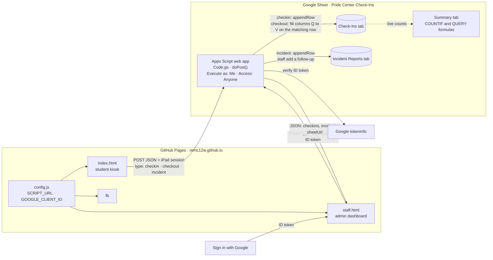
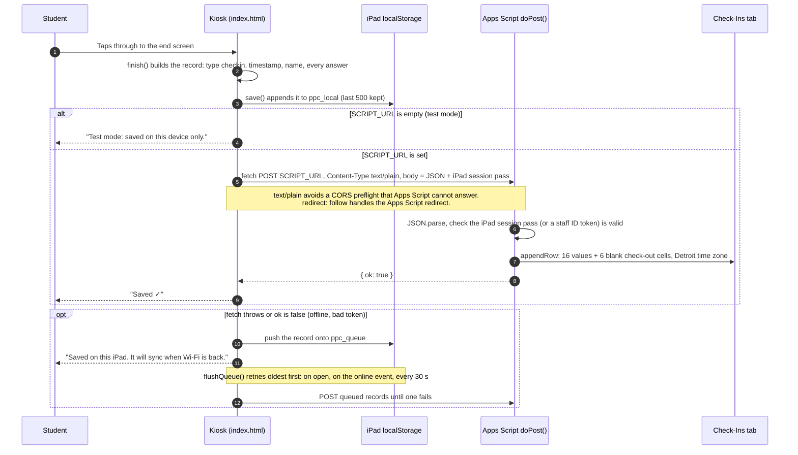
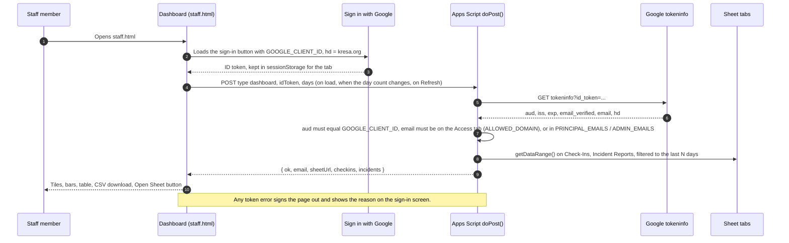

# Panther Pride Center – Student Check-In

A tap-through check-in kiosk for the Pride Center, rebuilt from the Google Slides deck so that every check-in is recorded in a Google Sheet and admins can see who came in, why, and how they were feeling.

- **Kiosk (live):** https://remc12w.github.io/panther-pride-checkin/
- **Staff sign-in (one link for all adults):** https://remc12w.github.io/panther-pride-checkin/login.html — sign in once and it opens your dashboard: the principal dashboard if the principal gave you that access, otherwise the staff dashboard (people with only Check-in iPad access go to the kiosk). The owners in `PRINCIPAL_EMAILS` get a choice of all three instead. Opening either dashboard directly while signed out goes here too.
- **Google Sheet:** [Pride Center Check-Ins](https://docs.google.com/spreadsheets/d/1CefuY4Uq8CgEqR6PQteZO4W02puMwbYvrsCOxdRQIgw/edit)
- **Repo:** https://github.com/REMC12W/panther-pride-checkin (GitHub Pages serves the `master` branch)

**What's in here**

| File | What it is |
|---|---|
| `index.html` | The student kiosk. Open this on the iPad. |
| `staff.html` | Admin dashboard behind "Sign in with Google", for staff on the approved list. In test mode, shows device-only data. |
| `config.js` | The only file you edit: script URLs, kiosk name, timers, basic-needs list. |
| `apps-script/Code.gs` | Backend that lives inside the Google Sheet. Verifies every sign-in against the approved list. |
| `apps-script/appsscript.json` | Optional manifest (sets the Michigan time zone). |
| `principal.html` | Principal dashboard: build-your-own boards of charts over the check-in data. Sample or live data. Uses `principal-data.js`, `principal-charts.js`, `principal-research.js`, `principal-app.js`, and the Vega chart library in `assets/vendor/`. |
| `sw.js` | Service worker. Lets the kiosk open with no Wi-Fi and keeps files fresh when online. |
| `ds.css` | Parchment Panthers Design System tokens (colors, Raleway type, buttons, corners) shared by every page. |
| `icons.js` | Lucide icons bundled for offline use. In `config.js`, an item's `icon` is a Lucide icon name. |
| `assets/` | District panther logo and app icons. |

## The flow

Matches the hyperlinks in the current PowerPoint deck.

1. Start → the student types their name and taps it in the roster name list (see "The roster name list" below)
2. Why are you here today? **I came on my own** (I have a need) or **Staff Referred** (a teacher sent me)
3. Self-referred: What do you need today? **I Need a Reset**, **Scheduled Break**, or **I have a need… (sickness, food, clothing, or to report something)**. Staff-referred: Why did a teacher send you? **Break**, **Defiance**, or **Sickness**. Staff-referred students never see Scheduled Break.
4. **I have a need** goes to: Incident Report or Basic Need. Incident Report opens a short in-app report: What happened (multi-select from `INCIDENT_TYPES`) → Where (`INCIDENT_PLACES`, with Bus/Bus Stop) → When (`INCIDENT_PERIODS`: Before School, Breakfast, the class hours, Lunch, Recess, Passing Time) → Tell us what happened (own words, who was involved, witnesses) → Do you want to talk to someone today? There is no "Are you safe?" question and no grade question: the script fills in the student's grade from the roster. Reports land in an **Incident Reports** tab in the Sheet and in the admin dashboard, where an adult records a follow-up. Basic Need opens "What do you need?" where the student taps one or more items from `BASIC_NEEDS` in `config.js`, then continues to the feelings questions below.
5. How is your body + brain feeling? (Fast / Slow / Ok)
6. "Pick the word that fits how you feel." Fast shows the red and yellow grids, Slow shows blue, Ok shows green. A student can tap one word, or tap **Type my own word** under a grid and type it; the Sheet records their word with that grid's color.
7. Did something happen… (At Home / With my Teacher / With a friend / Just with myself / Nothing happened / I'm not sure right now)
8. Station suggestion. The mood word's color picks a regulation station (Red, Yellow, Blue, Green). The app says "Suggested: Blue station. You can pick another," and records both the suggestion and the choice. Every word goes to the station picker, including the alert words in `STAFF_FIRST_WORDS` (enraged, hopeless, and so on), since an adult is already with the student. A tapped alert word is saved with "Staff first" in Station Suggested, which raises "Staff should go to this student" on the staff dashboard. A word the student typed never raises an alert.
9. End screen with the deck's CLICK HERE button: Incident Report opens the incident form, Check In and Basic Need open the sign-in form. Both need a KRESA Google login, exactly as before. Clear `FORM_INCIDENT_URL` or `FORM_SIGNIN_URL` in `config.js` to hide a button. The app resets for the next student after 30 seconds.

**Already checked in?** After typing their name, a student who already has an open check-in today on that iPad (within 4 hours, not checked out) sees "Welcome back" with two choices: check out, or start a new visit. A student who taps check-out without a check-in sees "We don't see a check-in for you today" with: check in, or check out anyway. So nobody answers the check-in questions twice by accident. This uses the iPad's own record, so a staff check-out from the dashboard isn't known to the iPad; "start a new visit" covers that case.

**Confirmation screens** lead with a big block in the color of the station they're headed to, with "You picked: <their word>." The wording is plain and tells students what happens next, never how to feel: "You're checked in," "Your report is saved," "Your request is saved."

**Back** is a large dark button fixed in the bottom-left corner of every question screen. Start over stays in the top right.

**Check-out.** The start screen has a "Leaving? Tap here to check out" link. The student types their name, answers the body + brain question and the word grid again, then taps what helped (from `WHAT_HELPED` in `config.js`). The Sheet fills in the check-out columns on that student's check-in row: check-out time, minutes in room, mood at check-out, and what helped. The end screen repeats the student's word ("You picked: Calm") and says the check-out is saved.

Every check-in is saved the moment the end screen appears. If Wi-Fi drops, it's kept on the iPad and synced automatically when the connection returns. If a student walks away mid-flow, the app returns to the start after two minutes so nobody sees their answers.

## Who can enter data

Nothing about a student is saved unless an approved staff member has signed the iPad in. The approved list is the **Access** tab in the Google Sheet, which the principal manages from **People & access** on the principal dashboard: one Google account per row: @parchmentschools.org staff, or a partner's Workspace account such as @kresa.org (Pride Center staff, anyone who should run the iPad or see a dashboard). Each person must sign in with their organization's account, not a personal Gmail. The same list gates the kiosk iPad, the staff dashboard and the principal dashboard. Students also have @parchmentschools.org accounts, so being on the domain is never enough on its own.

- **Not signed in?** The iPad start screen shows "Check-in is off" with a staff sign-in button instead of Get Started. Students can't begin.
- **Signed in?** The iPad holds its own pass for about 30 days (`KIOSK_SESSION_DAYS`) and sends it with every check-in, check-out and incident report. The script refuses anything without a valid pass. There is no shared secret in `config.js` to find.
- **Taken off the list?** The pass stops working on the next save or lookup, and the iPad locks again.
- **Lost Wi-Fi?** Check-ins wait on the iPad and send when it's back. If the iPad was signed out or expired meanwhile, they still wait; the lock screen says how many and they go out as soon as someone signs in.
- `PRINCIPAL_EMAILS` (the principal and ben.tomlinson@kresa.org) and `ADMIN_EMAILS` in `Code.gs` are always allowed, so an empty Access tab can never lock everyone out.

The principal edits the list from the principal dashboard; nobody needs edit access to the Sheet itself. Keep the Sheet unshared.

## How it connects to the Google Sheet

Nothing in this repo calls the Google Sheets API directly. The bridge is the Apps Script web app that lives inside the Sheet: the pages on GitHub Pages POST JSON to the script's URL, and the script writes the rows. Until `SCRIPT_URL` in `config.js` is filled in (Setup step 4), the kiosk runs in test mode and nothing reaches the Sheet.

### The pieces



Setup wires this together in order: paste `Code.gs` into the Sheet (step 2), run `setup` to build the tabs (step 3), deploy as a web app and paste its URL into `config.js` (step 4), create the OAuth Client ID for the dashboard (step 5), then push so GitHub Pages serves the new config (step 6).

### One check-in, step by step



Check-out and incident records travel the same road. The differences are on the Sheet side: a check-out does not add a row but finds the same name checked in within 6 hours with no check-out yet and fills columns Q to V of that row (or adds a "no check-in found" row), and an incident goes to the Incident Reports tab (created on first use). For every record, the script swaps the kiosk's roster key for the student's ID, full name, and grade from the Roster tab before saving.

### Dashboard read path



The Summary tab needs none of this. It is COUNTIF and QUERY formulas pointing at the Check-Ins tab, so it updates the moment a row lands.

## Setup (about 15 minutes, one time)

### 1. Open the Google Sheet

The sheet already exists: [Pride Center Check-Ins](https://docs.google.com/spreadsheets/d/1CefuY4Uq8CgEqR6PQteZO4W02puMwbYvrsCOxdRQIgw/edit). It's empty until the script builds the tabs.

### 2. Add the script

1. In the Sheet, go to **Extensions → Apps Script**.
2. Delete the sample code in `Code.gs` and paste in everything from `apps-script/Code.gs`.
3. Access is one approved list (see "Who can enter data" above): `PRINCIPAL_EMAILS` and `ADMIN_EMAILS` always, plus the @`ALLOWED_DOMAIN` Workspace accounts the principal adds under **People & access** on the principal dashboard. Everyone else is refused, on the iPad and on both dashboards.
4. There is no shared secret in `config.js`. Every check-in, check-out and incident report needs an approved staff sign-in: the kiosk iPad's session, or an approved staff Google sign-in on the staff page. Someone who finds the script URL can't add or read anything. (If an older copy of this script still has a `KIOSK_TOKEN` line, it is no longer used and can be deleted.)
5. Click **Save**.

### 3. Run setup once

1. In the function dropdown next to the Run button, pick **setup**, then click **Run**.
2. Google asks you to authorize. Choose your account, click **Advanced → Go to (project name)**, then **Allow**. This is normal for a script you wrote yourself.
3. Back in the Sheet you now have a **Check-Ins** tab with headers, a **Summary** tab with live counts, and a **Roster** tab. The Incident Reports tab appears on its first entry, and the **Access** tab the first time the principal saves the approved list.

Optional: run **testInsert** the same way to add a fake row and confirm it works. Delete that row afterward.

### 4. Deploy the script (once)

1. **Deploy → New deployment**. Click the gear next to "Select type" → **Web app**.
2. **Execute as: Me**. **Who has access: Anyone**.
3. **Deploy**, then copy the Web app URL into `config.js`:

```js
SCRIPT_URL: "https://script.google.com/macros/s/AKfy.../exec",
```

"Anyone" lets the iPad reach the script without the student logging in; the iPad's own staff pass (step 7) is what the script checks before saving anything. Nobody can read data through this URL without a verified Google sign-in (step 5). Opening it in a browser shows a plain notice page.

### 5. Set up "Sign in with Google" for the dashboard

The dashboard at `staff.html` uses Google's own sign-in. You need one OAuth Client ID, which takes about five minutes:

1. Go to https://console.cloud.google.com/ with your kresa.org account. Create a project (any name, for example "Pride Center").
2. **APIs & Services → OAuth consent screen**. User type **Internal** (only district accounts can sign in). Fill in the app name and your email, save.
3. **APIs & Services → Credentials → Create credentials → OAuth client ID**. Application type **Web application**.
4. Under **Authorized JavaScript origins** (the top box, not "Authorized redirect URIs") add `https://remc12w.github.io`. For local testing also add `http://localhost:8765`. Leave redirect URIs empty. If sign-in says "no registered origin," the address is in the wrong box.
5. **Create**, then copy the Client ID (it ends in `.apps.googleusercontent.com`).
6. Paste it into **both** places:
   - `config.js` → `GOOGLE_CLIENT_ID`
   - `Code.gs` → `GOOGLE_CLIENT_ID`, then **Deploy → Manage deployments → pencil → New version → Deploy**.

If Cloud Console is locked down in your district, ask your Google Workspace admin to create the Web application client with that origin, or to allow you to. Nothing else in the setup needs the console.

How it works: the sign-in button gives the browser a Google ID token. `staff.html` sends it with every data request, and `Code.gs` verifies it with Google, checks that the account is a @parchmentschools.org Workspace account on the Access tab (or listed in `PRINCIPAL_EMAILS` or `ADMIN_EMAILS`), and only then returns data. Tokens expire after an hour, at which point the page asks you to sign in again.

### 6. Publish the config

```bash
git add -A && git commit -m "Connect the Google Sheet" && git push
```

GitHub Pages updates in about a minute. The yellow "test mode" banner disappears from the kiosk, and `staff.html` shows the sign-in page.

**Updating to the roster name list and incident follow-up (October 2026).** This update changes Code.gs, so do these once: paste the new `apps-script/Code.gs` into Apps Script, then **Deploy → Manage deployments → pencil icon → Version: New version → Deploy** (the URL stays the same), then run **setup** once. Setup adds the Follow-up action and status columns to the Incident Reports tab, removes the old red highlight on "not safe" rows (any other rules you added stay), and rebuilds the Summary tab with the new reasons and answers. Until the new version is deployed, the iPad has no name list and accepts typed names, and the staff page warns that follow-up details weren't saved.

**If you later edit Code.gs**, publish a new version: **Deploy → Manage deployments → pencil icon → Version: New version → Deploy**. The URL stays the same.

### 7. Set up the iPad

1. Open the kiosk URL in Safari.
2. Tap **Share → Add to Home Screen**. It becomes a full-screen app with the panther icon.
3. On the start screen tap **Staff: Sign In This iPad** and sign in with an approved @parchmentschools.org account. The start screen then shows Get Started. Do this before Guided Access, since the sign-in opens a Google popup.
4. To lock the iPad to the app, enable **Settings → Accessibility → Guided Access**, open the app, then triple-click the top button.

## Admin dashboard

Open `staff.html` and sign in with a @parchmentschools.org staff account on the Access tab (or an account listed in `PRINCIPAL_EMAILS` or `ADMIN_EMAILS`). It is built around what staff act on, top to bottom:

1. **Needs attention.** Safety first: students who tapped an alert word today, then incident reports with no follow-up yet (or marked "Needs more follow-up"), students who checked out still red or blue, and up to three patterns from the last 7 days (3+ visits, or 2+ red/blue arrivals; scheduled breaks don't count). Older reports from when the kiosk asked "Are you safe?" still show "Said they are not safe" until followed up. Incident reports clear with **Follow up** (below). Other items clear with **Done** on that computer.
2. **In the room now.** Checked in within 3 hours and not checked out, with station, feeling word, basic needs, and minutes in the room. **Check out** lets staff check a student out with their own read of how the student seems (color, optional word, what helped). These are saved with "Staff: <email>" in the Checked Out By column; kiosk check-outs say "Student". Staff who aren't comfortable assigning a mood can choose **Check out, skip the read**, which records only the time the student left; those visits count toward time in the room but are left out of the mood-change numbers and never raise a "left still red or blue" alert. Check-out stays optional either way.
3. **Today.** Check-ins, red/blue arrivals, basic needs, and incident reports, each with a 14-school-day sparkline.
4. **How students arrived.** The Mood Meter as a 2x2, with counts, share, and top words per quadrant.
5. **Did the visit help?** For students who checked out: how many who came in red or blue left yellow or green, typical stay, and arrived vs. left bars.
6. **When.** Visits per school day, and check-ins by hour for staffing.
7. **What's behind the visits, what to keep stocked, what helped.**
8. **Referral, reason, energy, and station.** Station bars use the station colors and show how often students went where the app suggested.
9. **Visit log** with student search. Tap a name to see that student's visits and a row of mood dots, oldest to newest.
10. **Incident reports** (open first).

**Incident follow-up.** After an adult talks with the student, they tap **Follow up** on the report and fill in a three-part form: what was done (Talked it through, Contacted family, Sent to office, Referred to counselor, Other), status (Resolved, or Needs more follow-up), and an optional note. It saves to the report's row: Reviewed by (your email and the time), Notes (added to, never replaced), Follow-up action, and Follow-up status. "Needs more follow-up" keeps the report in Needs attention, with an **Add follow-up** button, until a later follow-up marks it Resolved.

The **Today** button in the header (with today's check-in count) slides out a timeline of the day: every check-in, check-out, and incident report in order, grouped by hour, with chips for feeling word, reason, station, basic needs, minutes in the room, and what helped, plus a "Now" line. Filter it to check-ins, check-outs, items that need a staff member, or basic needs. Tap a name to jump to that student's history. Esc or a click outside closes it.

The window selector (7, 14, 30, 90 days) drives sections 4 through 9. Sections 1 through 3 are always about today and this week. Mood colors were checked for color-blind safety in light and dark mode, and every color is paired with a word.

## The roster name list

Students don't scan a badge or type an ID. They start typing their name, and matching students from the roster appear under the box as "Jordan S. · 7th." Tapping their name ties the visit to that student. The list starts after two letters and shows at most six names. The iPad shows first names, last initials, and grades, and never student IDs, except in the rare collision described below.

**Matching.** Typing "jor" lists every Jordan. Enter (or Next) picks a name by itself only when the typed name can mean just one student, for example "Jordan S." when there is one; otherwise the student is asked to tap their name. A name that isn't on the roster shows "We can't find that name. Ask an adult to help," and the adult adds the student to the Roster tab. When two students would show the same label, the script adds more of the last name ("Jordan Sa." and "Jordan Sm."), and if they still match, the last three digits of the student ID.

**Roster.** The roster is a **Roster** tab in the main Sheet ([open it](https://docs.google.com/spreadsheets/d/1CefuY4Uq8CgEqR6PQteZO4W02puMwbYvrsCOxdRQIgw/edit?gid=1679508098#gid=1679508098)); `ROSTER_SHEET_GID` in `Code.gs` points at it. Columns: Student ID, First Name, Last Name, Grade. Add a **Preferred Name** column to show a student's chosen name instead of their legal first name; a filled-in Preferred Name always wins, on the iPad and in the Sheet. Running `setup` formats the tab: frozen header, IDs kept as text, a 6/7/8 grade dropdown, and instructions in a note on the Student ID header. Header names are matched loosely (Student Number, ID, Surname, Grade Level all work), so a pasted export works too. Changes are picked up within 10 minutes, or right away after running **refreshRoster**, which also logs how many students it found. Anyone given edit access to fill in the roster can also see every other tab (check-ins, incident reports). To avoid that, set `ROSTER_SPREADSHEET_ID` to a separate spreadsheet and share only that. The roster never goes in this public repository.

**What the iPad gets.** After sign-in, the iPad downloads the list into memory only, never into browser storage, and refreshes it on the start screen every 10 minutes. Each student comes with a label, a first name for "Hi, Jordan!", and an opaque key (a salted hash) instead of their student ID. When a check-in, check-out, or incident report is saved, the script turns the key back into the student ID, full name, and grade.

**iPad sign-in.** The same staff sign-in that unlocks check-in (see "Who can enter data") turns on the roster name list, so nobody can pull names from the roster, and the same sign-in is what lets the iPad save anything at all. Tap **Staff: Sign In This iPad** on the locked start screen, or tap the panther on the start screen 5 times to open iPad Setup at any time (to see who it's signed in as, or sign it out). The approved list is re-checked on every request and save. Because Parchment accounts are outside the kresa.org Google Workspace that owns the sign-in app, its OAuth consent screen must be set to **External** (Google Cloud Console → Google Auth Platform → Audience → Make external, publishing status In production). To sign every iPad out, for example if one goes missing, run **signOutAllKiosks** in Apps Script. Sign the iPad in before turning on Guided Access, since the sign-in opens a Google popup.

If the iPad isn't signed in or can't reach the script, there is no name list: the student types their first and last name, and staff confirm it on the dashboard.

**Staff confirm.** On the dashboard, each student under "In the room now" has **✓ Confirm** and **Not them**. Confirm records "Confirmed · your email · time" in the Staff Confirmed column. Not them flags the visit in the Sheet, the visit log, and the Today timeline, and puts a "Check-in not by this student" item in Needs attention so someone fixes the name. Flagged visits are not deleted and still count in the charts until the name is corrected.

## Principal dashboard

`principal.html` is a report builder for school leaders. It opens with three starter boards (Overview, Incidents, Support) and every tile can be changed, moved, resized, copied, or deleted.

**Tiles.** Each tile is a question: a **measure** (visits, unique students, minutes in room, % arriving red or blue, % leaving green or yellow, % who came in red/blue and left green/yellow, % alert words, incident reports, % followed up, days to follow-up, and more) **grouped by** something (week, day of week, hour, grade, reason, mood, station, what helped, student, incident type, place, period, status…), drawn as bars, horizontal bars, stacked or grouped bars, line, area, pie, donut, heatmap, calendar, scatter, table, a big number, or a flow from mood on arrival to mood at check-out. Every tile can **compare**: the previous period of the same length, groups side by side (for example grade 6 vs 7 vs 8), a second measure on the same chart, or one student against everyone. Tiles take their own filters (grade, how they came, reason, mood, station, place, period, status, day of week) and their own date range, or follow the board's.

**Drill-down.** Tap any bar, slice, cell, table row, or big number to see the visits or reports behind it, with names. From a student's row, "Compare to everyone" adds a tile for that student.

**Boards.** Tabs across the top. **Grid layout** is a dashboard: drag a tile by its handle to move it, drag the corner to resize. **List layout** is a report: one row per tile, a headline on the left (the top item, the latest value, the busiest time) and a small chart on the right, with arrows to reorder. Tap a headline to see the records behind it. The board is **locked** by default so a finger scrolling an iPad never moves a tile; tap **Locked** to edit, then lock again. The Board menu renames, duplicates, prints (clean two-column layout for a PDF or packet), copies a **share link** that another leader can open to add the board to their own page, restores the starters, or deletes.

**Exports.** Every tile's menu has **Download numbers** (CSV of exactly what the chart shows) and **Copy as image** (paste into a slide or email).

**Who can open it.** The owners in `PRINCIPAL_EMAILS` in `Code.gs` (the principal, jeremy.andrick@parchmentschools.org, and ben.tomlinson@kresa.org for setup) can always open it. Everyone else is on the **Access** list, which the principal manages from **👥 People & access** on this page: add an email and tick **Staff dashboard**, **Principal dashboard**, **Check-in iPad**, or a mix. Check-in iPad lets someone sign in the Pride Center iPad so students can check in, without seeing either dashboard; either dashboard box already includes it. The list is saved to an **Access** tab in the Sheet and the script checks it on every request, so it can't be bypassed from the browser. Listed people must sign in with their school Workspace account; a personal Google account using the same address is refused. The page asks for sign-in even in demo mode.

**The same list runs the iPad.** Anyone on the Access list can sign the Pride Center iPad in: people with a dashboard box, and people with only the Check-in iPad box (they can't open a dashboard). Nobody else can, students with district accounts included. Until the principal saves the list for the first time, only the owners and `ADMIN_EMAILS` can. Removing someone takes effect on their next request, and an iPad they signed in locks again.

**Sample or Live.** The header has a **Sample / Live** switch, remembered per browser. Sample is a made-up school year (this year and the one before, so "vs previous period" has data) with every grade, place, period, and incident type represented. Live reads the Sheet through the script with the same Google sign-in as the staff page and leaves out setup and "(sample)" test rows. `PRINCIPAL_DEMO` in `config.js` only sets which one opens first. Boards save to a **Dashboards** tab in the Sheet (one row per signed-in email) in both modes, so they follow the person to any device. Grades on live rows come from the **Roster** tab; until it has students, the grade chips say so instead of filtering everything away. Live needs the current `Code.gs` deployed (it adds the `boardLoad`, `boardSave`, and access routes, locking so two saves can't collide, and sends the page only the columns it charts, never the private story, witness, or notes text). After pasting it, use Deploy → Manage deployments → New version of the existing deployment.

**Editing safety.** Delete and Reset have an **Undo** toast; the Account menu holds Sign out, People & access, and Research library; a board that has no tiles offers **Add the starter tiles**; changes made offline are kept and retried when the network returns, and a stale tab can't overwrite newer boards saved from another device.

### Research library

Each starter board opens with a one-line **research notice** that reads the board's own numbers (same date range and grade chips) and points at the culture-and-climate card that fits, for example "71% of 441 visits arrived red or blue → Teach the feeling words". **Research library** in the header (under **Account** and the header) holds all 14 cards, filterable by topic. A card says when to reach for it, what the research found, what to try this month, and where it comes from. Tap a card's **Pin to board** to keep it on a board.

| Topic | Card |
|---|---|
| Belonging | Make sure every student is known |
| Teacher–student relationships | Greet students at the door |
| Discipline | Try empathic discipline |
| Restorative practices | Repair harm with restorative talks |
| Unstructured time | Put adults where incidents happen |
| Bullying prevention | Run a whole-school bullying response |
| Emotion regulation | Teach the feeling words |
| Routines | Give mornings a soft landing |
| Basic needs | Meet basic needs first |
| Tier 2 support | Start Check-In/Check-Out |
| Follow-up | Close the loop within 48 hours |
| Student voice | Bring students into the data |
| Schoolwide systems | Re-teach schoolwide expectations |

The cards summarize published studies and cite them (Allen et al. 2018, Roorda et al. 2011, Okonofua et al. 2016, Ttofi & Farrington 2011, Durlak et al. 2011, Bradshaw et al. 2010, and others). They are a starting point for staff conversations, not a diagnosis of any student, and the school team should read the sources before acting on them. The cards and the rules that match them live in `principal-research.js`.

## Offline and updates

The kiosk registers a service worker. After the first successful load, the app opens even with no Wi-Fi, and check-ins made offline are queued on the iPad and synced when the connection returns (and, if the iPad was signed out meanwhile, as soon as staff sign it in again). When online, every file is revalidated on open, so a `config.js` change reaches the iPad the next time the app is opened, not a day later. The version number in the bottom-left corner of the kiosk comes from `APP_VERSION` in `index.html`; bump it when you change the app so staff can tell which version an iPad is running.

## Test mode

With `SCRIPT_URL` empty, the kiosk saves check-ins in the browser on that device only, and `staff.html` shows them. The iPad lock is off in test mode. Good for a first look and for training staff before the Sheet is connected.

## Accessibility

Target: WCAG 2.1 Level AA, the standard the U.S. Department of Justice's 2024 ADA Title II rule sets for public school districts' web content. Checked on 2026-10-25.

What the app does for it:

- **Contrast.** Every text and icon meets AA contrast. Mood Meter tiles and station cards pick white or dark text automatically for each color, so the Mood Meter colors never change. The menu colors (maroon, teal, plum, orange, berry) were chosen to pass with dark labels on the shade and white text when tapped.
- **Not color alone.** Selected cards keep a check mark; mood strips and dots on the dashboard carry text labels.
- **Zoom.** The kiosk allows pinch-zoom; nothing scrolls sideways at 320 px wide or at 200% zoom.
- **Keyboard and screen readers.** Every step works with a keyboard and shows a focus ring. Each new kiosk question receives focus so screen readers announce it. Fields have labels; save messages are announced. The name suggestions work with arrow keys.
- **Time limits.** Twenty seconds before the idle reset the kiosk asks "Are you still there?" and any tap keeps going. End screens count down from at least 20 seconds and have a **More time** button (+30 seconds).
- **Charts.** Staff dashboard charts have a written summary (screen readers read it; keyboard users get it as a tooltip). Principal dashboard charts have a hidden data table for screen readers and **Show the numbers** in each tile's menu for everyone. Tiles can be moved with the arrow buttons and resized with the arrow keys.
- **Motion.** Press animations turn off when the device is set to reduce motion.

How it was checked: axe-core 4.13 (WCAG 2.1 A and AA rules) on 82 screens and states across every kiosk path, the login page and both dashboards, with zero violations; a keyboard-only check-in; sideways-scroll checks at 320 px and 200% zoom; WCAG text-spacing overrides; and the iPad no-scroll check at six sizes.

Not covered by those checks: a full pass with VoiceOver on the actual iPad (recommended once a year or after big changes), Google's own sign-in button (Google's responsibility), and the separate demo site.

## Privacy notes

- **Sample data:** rows whose Kiosk column says `SAMPLE DATA` (names end in "(sample)") are demo rows for staff to explore. Run **deleteSampleData** in Apps Script to remove them all; real rows are untouched.
- Student names are stored only in the district Google Sheet. Nothing goes to any other service.
- The kiosk keeps a copy of the last 500 check-ins in the iPad browser's local storage so nothing is lost offline. Clear Safari website data on the iPad if you ever retire it.
- Every login is Google's own "Sign in with Google", verified by the script on every request. There is no password or PIN to manage. The Access tab (managed by the principal) plus `PRINCIPAL_EMAILS` and `ADMIN_EMAILS` in `Code.gs` control who gets in.
- The repo is public (GitHub Pages needs that on a free plan). It contains no student data. `config.js` holds only the script URL, the Google sign-in client ID, and wording; a web page has to send those to the browser, so they are visible, but none of them is a secret. Every request to the script, kiosk or dashboard, needs an approved staff sign-in. The old shared `KIOSK_TOKEN` is gone from the code; it remains in git history, where it no longer opens anything.

## Customizing

- **Timers, kiosk name, form links, basic-needs list, stations, staff-first words, what-helped list:** `config.js`
- **Question text and colors:** `index.html`, each screen is a `<section>`
- **Mood words:** the `GRIDS` object near the top of the script in `index.html`
- **Sheet columns:** `HEADERS` and `doPost` in `Code.gs`. If you change headers after the sheet has data, insert or rename the columns in the Sheet by hand to match.
